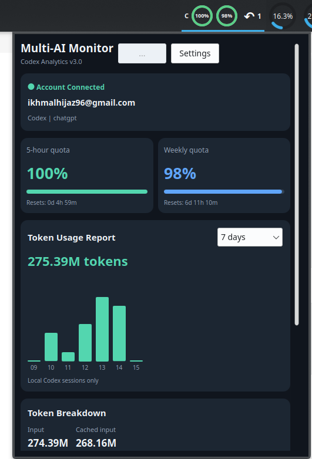
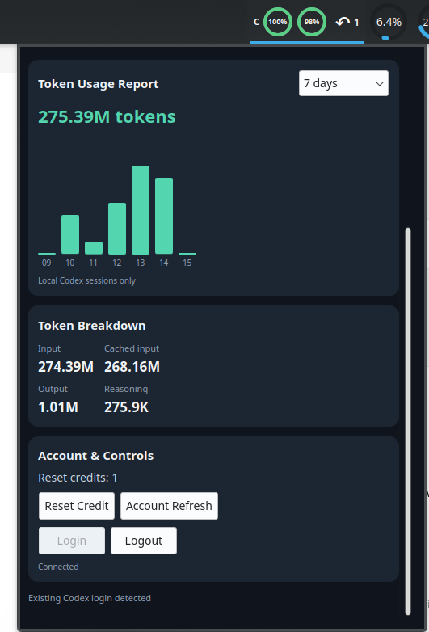
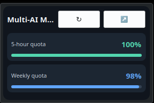
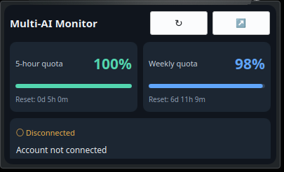
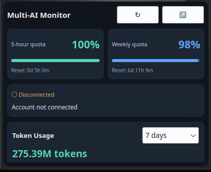
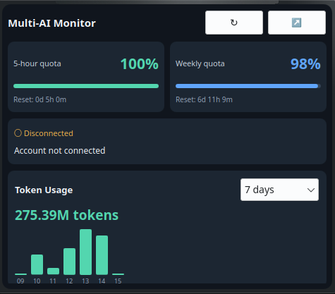
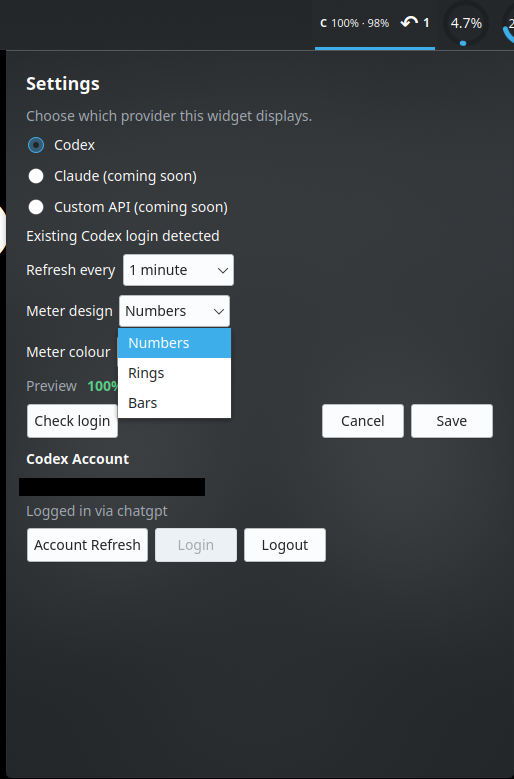
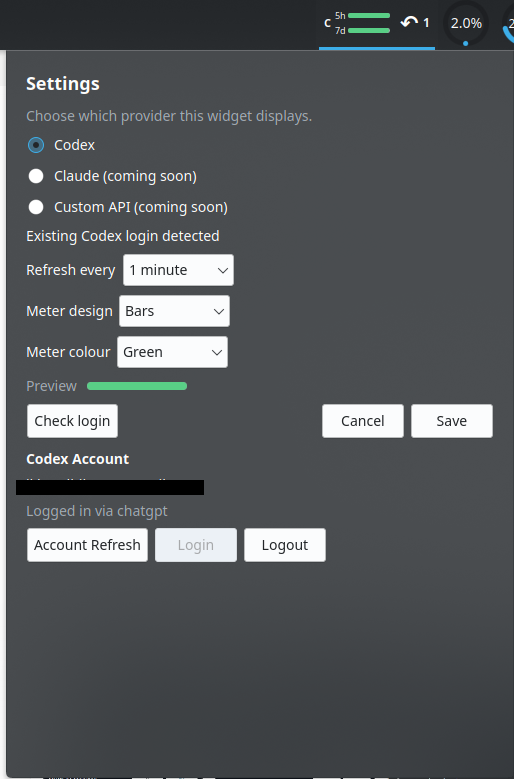
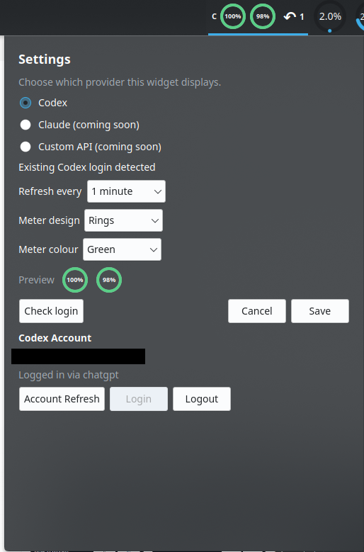

# Multi-AI Usage Monitor v3.1.0

<!-- SCREENSHOT_GALLERY_START -->
## Screenshots

See Multi-AI Usage Monitor in action on KDE Plasma 5.

### Dashboard and token analytics

| Main dashboard | Token analytics and controls |
|:---:|:---:|
|  |  |

### Responsive widget layouts

| Extra small | Small |
|:---:|:---:|
|  |  |

| Medium | Large |
|:---:|:---:|
|  |  |

### Settings and customization

| Numbers | Bars | Rings |
|:---:|:---:|:---:|
|  |  |  |

> Screenshots show example quota and token usage values. Claude and Custom API options are marked as coming soon.
<!-- SCREENSHOT_GALLERY_END -->

KDE Plasma 5 widget for Codex account quota and local token analytics.

## Features
- Adaptive desktop layouts (XS, Small, Medium, Large)
- Compact panel widget with click-to-open report
- 5-hour and weekly remaining quota display
- 7/30-day local token usage chart
- Account status, login/logout and reset-credit confirmation

## Requirements
- KDE Plasma 5 with `PlasmaCore 2.0` and QtQuick Controls 2
- Python 3
- ChatGPT Desktop Codex CLI at `/usr/lib/chatgpt/resources/codex` for account and reset helpers
- Existing Codex session JSONL files under `~/.codex/sessions` for token history

## Install
Extract the release and run `bash install.sh` from its directory.
The installer backs up an existing widget, installs required helper scripts and
replaces the original developer-specific `/home/uitm/` QML paths with your home directory.

**Important:** The installer has not been tested on another machine. The Codex
CLI location is currently specific to the ChatGPT Desktop Linux environment;
other distributions or CLI installs may require modifying the helper scripts.
Restart Plasma to reload the widget if necessary.

## Privacy and caution
Token report scans local JSONL session files but uses only token metadata.
Do not upload your `~/.codex` directory, account credentials or local state.
The Reset Credit action can consume a real credit; use only intentionally.
Login/logout may affect the shared Codex authentication session.

## License
No license has been selected yet. Do not assume open-source reuse rights
until the project owner adds a license.
